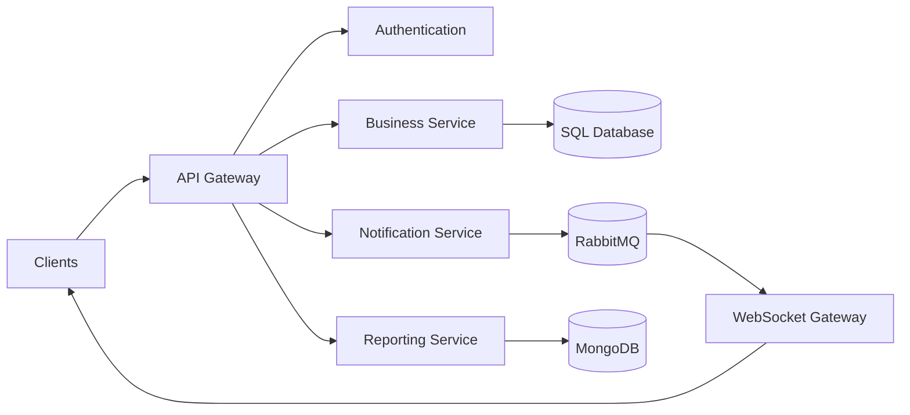

<!--
══════════════════════════════════════════════════════════════════════════════
  GitHub Profile README
  Author: Juan Dominid Muñoz Eslava
  Username: DominidM
══════════════════════════════════════════════════════════════════════════════
-->

<div align="center">


<a href="https://github.com/DenverCoder1/readme-typing-svg">
  
</a>

<br>

<a href="https://dominidm.github.io/">
  
</a>
<a href="https://solvegrades.com/nosotros/">
  
</a>
<a href="https://www.linkedin.com/in/juan-dominid-mu%C3%B1oz-eslava-50b68828a/">
  
</a>
<a href="https://leetcode.com/u/Dominid/">
  
</a>

<br><br>


</div>

---

## `> whoami`

```yaml
name: Juan Dominid Muñoz Eslava
role: Co-Founder & Full Stack Developer
company: Solvegrades Technology
focus:
  - Software Architecture
  - Enterprise Resource Planning
  - Microservices
  - Cloud-native Applications
  - Real-time Systems
education:
  degree: Computer Systems Engineering
  institution: UPN
  status: Final academic stage
currently_building:
  - Scalable business platforms
  - Citizen-impact technology
  - Environmental monitoring solutions
```

Soy desarrollador Full Stack orientado a la **arquitectura de software**, con experiencia diseñando soluciones empresariales desde cero y convirtiendo necesidades complejas en sistemas seguros, escalables y mantenibles.

Como **Co-Founder de Solvegrades Technology**, participo en el análisis, arquitectura y desarrollo de plataformas a medida, especialmente ERPs, sistemas de logística, aplicaciones cloud y servicios con comunicación en tiempo real.

- Arquitectura de sistemas con enfoque **hexagonal y clean architecture**.
- Diseño de **ERPs para importación, logística y gestión empresarial**.
- Integración de autenticación y autorización mediante **JWT + RBAC**.
- Implementación de comunicación en tiempo real con **WebSockets**.
- Integración de servicios relacionados con **facturación electrónica SUNAT**.
- Diseño de APIs, microservicios y sistemas desplegados en infraestructura cloud.
- Interés en proyectos con impacto **educativo, social y ambiental**.

---

## 🧭 Engineering mindset

```text
Understand the problem
        ↓
Model the business domain
        ↓
Design clear boundaries
        ↓
Build secure and testable components
        ↓
Measure, improve and scale
```

> No desarrollo solamente funcionalidades. Diseño sistemas capaces de evolucionar sin convertir cada nuevo requerimiento en un problema.

---

## 🚀 Selected projects

### 🌐 ComuniRed

Una plataforma de participación ciudadana diseñada para registrar reportes comunitarios y facilitar que las entidades municipales puedan realizar seguimiento, gestionar evidencias y comunicar soluciones.

```yaml
architecture:
  backend: Spring Boot
  frontend: Angular
  database: MongoDB Atlas
  api: GraphQL
  realtime: WebSockets
  cloud: Azure
  edge_and_security: Cloudflare
```

**Principales retos abordados:**

- Comunicación en tiempo real.
- Seguimiento del ciclo de vida de los reportes.
- Organización de información georreferenciada.
- Separación de responsabilidades entre ciudadanos y entidades.
- Diseño de infraestructura preparada para crecimiento.

---

### 🌊 OceanEyes

**Proyecto participante en Hult Prize UPN 2026**

Plataforma tecnológica orientada a la protección de ecosistemas marinos y al monitoreo de actividades relacionadas con la pesca ilegal.

```yaml
ecosystem:
  mobile_application:
    technology: Flutter
    capabilities:
      - GPS
      - Citizen reports
      - Field evidence

  monitoring_devices:
    capabilities:
      - Water quality sensors
      - Environmental telemetry

  web_dashboard:
    technology: Angular
    capabilities:
      - Georeferenced visualization
      - Incident monitoring
      - Environmental data analysis
```

El objetivo es conectar aplicaciones móviles, dispositivos de monitoreo y dashboards web en un ecosistema tecnológico que permita transformar datos ambientales en acciones oportunas.

---

## 🏗️ Architecture toolbox

<div align="center">



</div>

Mi enfoque arquitectónico suele considerar:

- Separación entre dominio, aplicación e infraestructura.
- Límites claros entre módulos y servicios.
- Seguridad basada en roles y permisos.
- Eventos y mensajería para procesos desacoplados.
- Observabilidad y control de errores.
- Estrategias de despliegue con contenedores.
- Diseño preparado para evolución progresiva.

---

## 🧰 Technology stack

### Backend & APIs

<div align="center">


</div>

### Frontend & Mobile

<div align="center">


</div>

### Databases & Messaging

<div align="center">


<br>


</div>

### Cloud, DevOps & Tools

<div align="center">


</div>

---

## 🧬 Developer profile

```typescript
type Architecture =
  | "Hexagonal Architecture"
  | "Clean Architecture"
  | "Modular Monolith"
  | "Microservices";

interface DeveloperProfile {
  role: string[];
  architecture: Architecture[];
  backend: string[];
  frontend: string[];
  infrastructure: string[];
  principles: string[];
}

const dominid: DeveloperProfile = {
  role: [
    "Co-Founder",
    "Software Architect",
    "Full Stack Developer"
  ],

  architecture: [
    "Hexagonal Architecture",
    "Clean Architecture",
    "Modular Monolith",
    "Microservices"
  ],

  backend: [
    "Spring Boot",
    "NestJS",
    "Express",
    "GraphQL",
    "WebSockets"
  ],

  frontend: [
    "Angular",
    "Next.js",
    "Flutter"
  ],

  infrastructure: [
    "Docker",
    "Azure",
    "Cloudflare",
    "RabbitMQ",
    "Supabase"
  ],

  principles: [
    "Security by design",
    "Maintainability",
    "Clear boundaries",
    "Business-oriented software",
    "Continuous improvement"
  ]
};

function buildSolution(problem: string): string {
  return `Analyze ${problem}, model the domain, design the architecture and ship value.`;
}
```

---

## 📊 GitHub analytics

<div align="center">


</div>

> Las estadísticas de lenguajes representan principalmente la composición de los repositorios públicos y no determinan por sí solas el nivel de dominio técnico.

<div align="center">


</div>

---

## 🐍 Contribution activity

<div align="center">


</div>

> Si la animación todavía no aparece, debes instalar el workflow incluido más abajo.

---

## 🎯 Current roadmap

```text
[████████████████░░░░] Software Architecture
[███████████████░░░░░] Distributed Systems
[██████████████░░░░░░] Cloud Engineering
[████████████░░░░░░░░] DevOps & Observability
[██████████░░░░░░░░░░] Artificial Intelligence Integration
```

Actualmente estoy profundizando en:

- Patrones para sistemas distribuidos.
- Observabilidad y monitoreo de aplicaciones.
- Arquitecturas orientadas a eventos.
- Automatización de despliegues.
- Optimización de rendimiento.
- Integración responsable de inteligencia artificial en productos de software.

---

## 🤝 Let's build something meaningful

Estoy abierto a colaborar en:

- Plataformas educativas.
- Sistemas empresariales y ERPs.
- Aplicaciones de impacto ciudadano.
- Tecnología para sostenibilidad y medioambiente.
- Arquitecturas backend y APIs escalables.
- Proyectos open source.

<div align="center">

<a href="https://www.linkedin.com/in/juan-dominid-mu%C3%B1oz-eslava-50b68828a/">
  
</a>

<a href="https://dominidm.github.io/">
  
</a>

</div>

<br>

<div align="center">

### “Architecture is not about adding complexity. It is about controlling it.”


</div>
