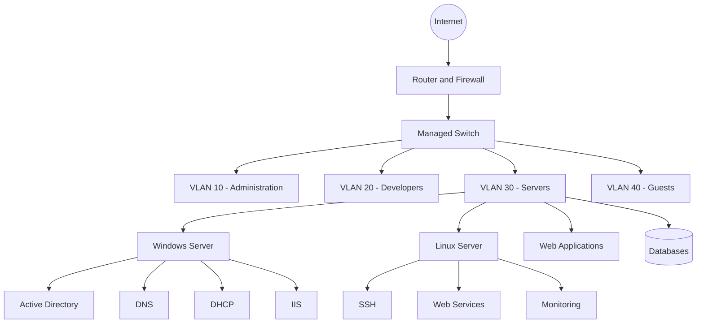
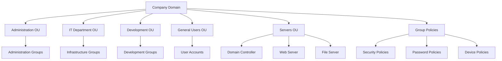
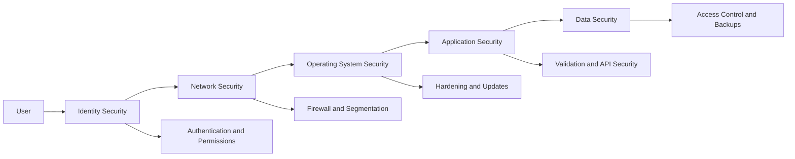
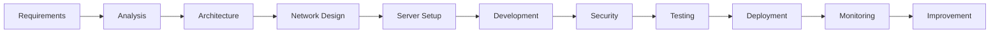
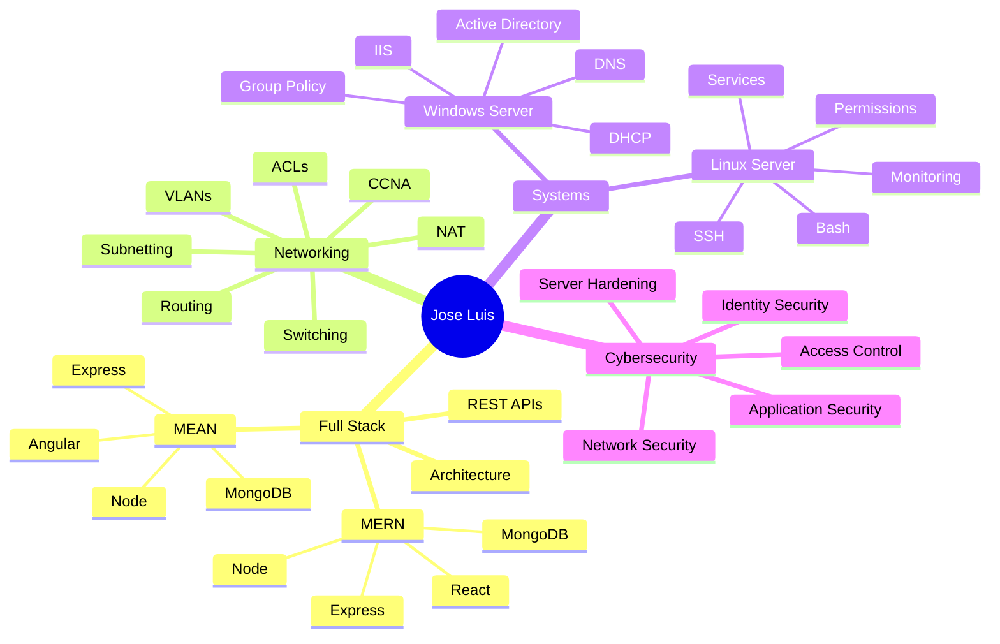

<!--
==============================================================================
  GitHub Profile README
  Nombre: Jose Luis Rodriguez Navarro
  Usuario: Josepfazt
  Perfil: Full Stack | Redes | Sistemas | Ciberseguridad
==============================================================================
-->
---

<div align="center">


<a href="https://github.com/DenverCoder1/readme-typing-svg">
  
</a>

<br>

<a href="https://github.com/Josepfazt">
  
</a>

<a href="mailto:jazzRN1321@gmail.com">
  
</a>

<a href="www.linkedin.com/in/jose-luis-rodríguez-navarro-43981b211">
  
</a>

<br><br>


</div>

---

## `> whoami`

```yaml
profile:
  name: "Jose Luis Rodriguez Navarro"
  username: "Josepfazt"
  role: "Full Stack Developer"
  location: "Lima, Peru"

specializations:
  software_development:
    - "MERN Stack"
    - "MEAN Stack"
    - "REST API Development"
    - "Object-Oriented Programming"
    - "Software Architecture"

  network_infrastructure:
    - "CCNA Networking Fundamentals"
    - "Routing and Switching"
    - "IPv4, IPv6 and Subnetting"
    - "VLANs, NAT and ACLs"
    - "DNS and DHCP"

  systems_administration:
    - "Windows Server"
    - "Linux Server"
    - "Active Directory"
    - "Group Policy"
    - "IIS"
    - "Bash and PowerShell"

  cybersecurity:
    - "Network Security"
    - "Server Hardening"
    - "Access Control"
    - "Identity and Permissions"
    - "Security Best Practices"

mission: >
  Build complete technology solutions, from network infrastructure
  and server administration to secure and scalable Full Stack applications.
```

Soy **Jose Luis Rodriguez Navarro**, programador Full Stack con conocimientos en desarrollo de aplicaciones mediante los stacks **MERN y MEAN**, infraestructura de redes, sistemas operativos, administración de servidores y fundamentos de ciberseguridad.

Mi perfil combina desarrollo e infraestructura. Me interesa comprender todo el recorrido de una solución tecnológica: desde el código y la base de datos hasta la red, el sistema operativo, el servidor, los permisos y la seguridad.

- 💻 Desarrollo aplicaciones Full Stack con **MERN y MEAN**.
- 🌐 Cuento con conocimientos de redes y fundamentos de **CCNA**.
- 🖥️ Administro entornos **Windows Server y Linux Server**.
- 🏢 Trabajo con **Active Directory, GPO, DNS, DHCP e IIS**.
- 🔐 Aplico fundamentos y buenas prácticas de **ciberseguridad**.
- 🐧 Utilizo **Linux** como entorno de desarrollo y administración.
- ⚙️ Me interesa la automatización, arquitectura y operación de sistemas.
- 📚 Continúo fortaleciendo mis conocimientos mediante proyectos y laboratorios.
- 🤝 Estoy abierto a colaborar en proyectos tecnológicos y de código abierto.

---

# 🧭 Professional focus

<div align="center">

<table>
<tr>
<td align="center" width="33%">

### 💻 Software

MERN y MEAN  
Frontend y Backend  
APIs REST  
Bases de datos  
Arquitectura  
Git y GitHub  

</td>
<td align="center" width="33%">

### 🌐 Infrastructure

Redes y CCNA  
Routing y Switching  
Windows Server  
Linux Server  
Active Directory  
DNS, DHCP e IIS  

</td>
<td align="center" width="33%">

### 🔐 Security

Network Security  
Server Hardening  
Access Control  
Identity Management  
Least Privilege  
Security Practices  

</td>
</tr>
</table>

</div>

---

## 🧠 Engineering mindset

```text
┌──────────────────────────────────────────────────────────────┐
│                     TECHNOLOGY SOLUTION                      │
├────────────────────┬───────────────────┬─────────────────────┤
│    APPLICATION     │  INFRASTRUCTURE   │      SECURITY       │
├────────────────────┼───────────────────┼─────────────────────┤
│ Frontend           │ Network           │ Authentication      │
│ Backend            │ Operating System  │ Authorization       │
│ API                │ Server            │ Access Control      │
│ Database           │ Services          │ Hardening           │
│ Architecture       │ Monitoring        │ Auditing            │
└────────────────────┴───────────────────┴─────────────────────┘
```

> No me interesa únicamente que una aplicación funcione. También debe estar correctamente estructurada, desplegada, conectada, administrada y protegida.

---

# 💻 Full Stack Development

## MERN Stack

<div align="center">


<br>

**MongoDB · Express.js · React · Node.js**

</div>

El stack MERN me permite desarrollar aplicaciones usando JavaScript en las diferentes capas de la solución:

- Interfaces dinámicas con React.
- APIs y lógica de negocio con Node.js y Express.js.
- Persistencia de información con MongoDB.
- Autenticación y autorización.
- Operaciones CRUD.
- Consumo y desarrollo de APIs REST.
- Separación entre frontend y backend.
- Gestión de estados y componentes.
- Manejo de rutas, controladores y servicios.

---

## MEAN Stack

<div align="center">


<br>

**MongoDB · Express.js · Angular · Node.js**

</div>

También desarrollo soluciones mediante el stack MEAN:

- Aplicaciones estructuradas con Angular.
- Componentes, servicios y módulos.
- Programación con TypeScript.
- Formularios y validaciones.
- Comunicación con APIs REST.
- Backend con Node.js y Express.js.
- Persistencia de información en MongoDB.
- Organización modular del proyecto.

---

## Development stack

### Frontend

<div align="center">


</div>

### Backend

<div align="center">


</div>

### Databases

<div align="center">


</div>

### Development tools

<div align="center">


</div>

---

## 🧬 Developer profile

```javascript
class JoseLuis {
    constructor() {
        this.name = "Jose Luis Rodriguez Navarro";
        this.username = "Josepfazt";
        this.role = "Full Stack Developer";

        this.development = {
            stacks: ["MERN", "MEAN"],
            frontend: [
                "React",
                "Angular",
                "JavaScript",
                "TypeScript",
                "HTML",
                "CSS"
            ],
            backend: [
                "Node.js",
                "Express.js",
                "REST APIs",
                "Java"
            ],
            databases: [
                "MongoDB",
                "MySQL",
                "PostgreSQL"
            ]
        };

        this.infrastructure = {
            networking: [
                "CCNA Fundamentals",
                "Routing",
                "Switching",
                "VLANs",
                "Subnetting",
                "NAT",
                "ACLs"
            ],
            servers: [
                "Windows Server",
                "Linux Server",
                "Active Directory",
                "DNS",
                "DHCP",
                "IIS",
                "Group Policy"
            ]
        };

        this.security = [
            "Network Security",
            "Server Hardening",
            "Identity Management",
            "Access Control",
            "Least Privilege",
            "Security Best Practices"
        ];
    }

    buildSolution(requirements) {
        return {
            analysis: this.analyze(requirements),
            architecture: this.designArchitecture(requirements),
            implementation: "Clean and maintainable code",
            infrastructure: "Reliable server and network environment",
            security: "Protection applied across every layer",
            result: "Secure and scalable technology solution"
        };
    }

    analyze(requirements) {
        return `Analyzing: ${requirements}`;
    }

    designArchitecture(requirements) {
        return `Designing architecture for: ${requirements}`;
    }

    keepLearning() {
        return "Learn. Build. Test. Secure. Improve.";
    }
}

const joseLuis = new JoseLuis();

console.log(
    joseLuis.buildSolution("A complete Full Stack platform")
);
```

---

# 🌐 Networks and CCNA

<div align="center">


</div>

### Networking knowledge

```yaml
networking:
  fundamentals:
    - OSI Model
    - TCP/IP Model
    - Ethernet
    - Network Topologies
    - LAN and WAN

  addressing:
    - IPv4
    - IPv6
    - Subnetting
    - VLSM
    - Default Gateways

  switching:
    - MAC Address Tables
    - VLANs
    - Trunking
    - Inter-VLAN Routing
    - Spanning Tree Fundamentals

  routing:
    - Static Routing
    - Default Routes
    - Dynamic Routing Fundamentals
    - Route Analysis

  network_services:
    - DNS
    - DHCP
    - NAT
    - PAT
    - NTP

  security:
    - Access Control Lists
    - Port Security Fundamentals
    - Network Segmentation
    - Secure Remote Access

  troubleshooting:
    - Ping
    - Traceroute
    - IP Configuration
    - Connectivity Analysis
    - Protocol Diagnostics
```

---

## 🗺️ Network architecture



---

# 🖥️ Systems and server administration

## Operating systems

<div align="centerkill in "${LINUX_SKILLS[@]}"; do
    echo "[LINUX] $skill"
done
```

Mis conocimientos de administración Linux incluyen:

- Instalación y configuración del sistema.
- Administración de usuarios y grupos.
- Permisos de archivos y directorios.
- Gestión de paquetes.
- Procesos y servicios.
- Configuración de red.
- Acceso remoto mediante SSH.
- Revisión de logs.
- Automatización básica mediante Bash.
- Configuración de servicios web.
- Aplicación de buenas prácticas de seguridad.

---

## Windows Server

<div align="center">

  
  
  

</div>

```yaml
windows_server:
  identity:
    - Active Directory Domain Services
    - Users and Groups
    - Organizational Units
    - Domain Management
    - Authentication and Authorization

  policies:
    - Group Policy Objects
    - Security Policies
    - User Policies
    - Computer Policies

  network_services:
    - DNS Server
    - DHCP Server
    - IP Address Assignment
    - Name Resolution

  web_services:
    - Internet Information Services
    - Website Deployment
    - Application Pools
    - Basic Web Server Administration

  administration:
    - Server Roles
    - File and Folder Permissions
    - Services
    - Event Viewer
    - PowerShell Fundamentals
```

---

## 🏢 Active Directory structure



---

# 🔐 Cybersecurity

<div align="center">

  
  
  

</div>

### Security knowledge

```yaml
cybersecurity:
  network_security:
    - Network Segmentation
    - Firewall Fundamentals
    - Access Control Lists
    - Secure Protocols
    - Traffic Analysis Fundamentals

  system_security:
    - Windows Security
    - Linux Security
    - Server Hardening
    - Service Management
    - Patch Management Fundamentals

  identity:
    - Authentication
    - Authorization
    - Role-Based Access Control
    - Least Privilege
    - Password Policies
    - Active Directory Security

  application_security:
    - Input Validation
    - Secure Authentication
    - Environment Variables
    - Secret Management Fundamentals
    - API Protection
    - Error Handling

  operational_security:
    - Log Analysis
    - Backup Awareness
    - Security Monitoring
    - Vulnerability Awareness
    - Incident Response Fundamentals
```

---

## 🛡️ Defense-in-depth approach



> La seguridad no debe agregarse únicamente al finalizar un proyecto. Debe considerarse desde el diseño de la aplicación, la infraestructura y la administración de identidades.

---

# 🧪 Infrastructure and development lab

```text
                              INTERNET
                                  │
                                  ▼
                      ┌───────────────────────┐
                      │  ROUTER / FIREWALL    │
                      │  NAT · ACL · SECURITY │
                      └───────────┬───────────┘
                                  │
                                  ▼
                      ┌───────────────────────┐
                      │    MANAGED NETWORK    │
                      │  VLAN · DNS · DHCP    │
                      └─────┬─────────┬───────┘
                            │         │
              ┌─────────────┘         └─────────────┐
              ▼                                     ▼
┌──────────────────────────┐          ┌──────────────────────────┐
│      WINDOWS SERVER      │          │       LINUX SERVER       │
├──────────────────────────┤          ├──────────────────────────┤
│ Active Directory         │          │ SSH                      │
│ DNS                      │          │ Users and permissions    │
│ DHCP                     │          │ Web services             │
│ Group Policy             │          │ Process management       │
│ IIS                      │          │ Logs and monitoring      │
└────────────┬─────────────┘          └────────────┬─────────────┘
             │                                     │
             └──────────────────┬──────────────────┘
                                ▼
                  ┌───────────────────────────┐
                  │  FULL STACK APPLICATIONS  │
                  ├───────────────────────────┤
                  │ MongoDB                   │
                  │ Express.js                │
                  │ React / Angular           │
                  │ Node.js                   │
                  │ REST APIs                 │
                  └───────────────────────────┘
```

Este laboratorio representa la integración de mis diferentes áreas de conocimiento:

1. Diseño y segmentación básica de la red.
2. Configuración de servicios de infraestructura.
3. Administración de identidades y permisos.
4. Configuración de servidores Windows y Linux.
5. Despliegue de aplicaciones y servicios.
6. Aplicación de controles de seguridad.
7. Diagnóstico y resolución de problemas.

---

# 🏗️ How I build solutions



```text
01. Understand the business requirement
02. Identify users, roles and permissions
03. Design the application architecture
04. Prepare the network and server environment
05. Develop frontend, backend and database
06. Apply security controls
07. Test functionality and connectivity
08. Deploy the application
09. Monitor services and logs
10. Improve the complete solution
```

---

# 📂 Featured project

## ☕ SS9 · Java and Object-Oriented Programming

Repositorio dedicado a ejercicios y prácticas de programación orientada a objetos utilizando Java.

<div align="center">

<a href="https://github.com/Josepfazt">
  
  
</a>

</div>

### Concepts applied

- Clases y objetos.
- Atributos y métodos.
- Encapsulamiento.
- Constructores.
- Programación orientada a objetos.
- Organización de código.
- Fundamentos de Java.
- Control de versiones con Git.

---

# 📊 GitHub analytics

<div align="center">


</div>

> Las estadísticas muestran la composición de los repositorios públicos y no representan por sí solas el nivel de dominio de una tecnología.

<br>

<div align="center">


</div>

---

## 📈 Activity overview

<div align="center">


</div>

---

# 🐍 Contribution activity

<div align="center">
  


</div>

> La animación aparecerá después de instalar y ejecutar el workflow ubicado al final de este documento.

---

# 🗺️ Professional roadmap



---

# 🎯 Current objectives

```text
FULL STACK DEVELOPMENT       [████████████████░░░░]
MERN AND MEAN                [███████████████░░░░░]
NETWORKING AND CCNA          [██████████████░░░░░░]
WINDOWS SERVER               [█████████████░░░░░░░]
LINUX ADMINISTRATION         [█████████████░░░░░░░]
CYBERSECURITY                [████████████░░░░░░░░]
CLOUD AND DEVOPS             [████████░░░░░░░░░░░░]
```

Actualmente continúo desarrollando mis conocimientos en:

- Arquitectura de aplicaciones Full Stack.
- Desarrollo avanzado con MERN y MEAN.
- Seguridad de APIs y aplicaciones web.
- Administración de Windows Server.
- Automatización con PowerShell.
- Administración y seguridad de servidores Linux.
- Diseño y diagnóstico de redes.
- Fundamentos y prácticas de ciberseguridad.
- Contenedores y despliegue de aplicaciones.
- Cloud computing y DevOps.

---

# 🤝 Let's connect

Estoy abierto a:

- Colaborar en proyectos Full Stack.
- Participar en proyectos académicos y profesionales.
- Desarrollar aplicaciones con MERN y MEAN.
- Participar en laboratorios de redes y servidores.
- Colaborar en proyectos de infraestructura tecnológica.
- Aprender junto con otros desarrolladores y profesionales de TI.
- Contribuir a proyectos de código abierto.
- Intercambiar conocimientos sobre desarrollo, redes y seguridad.

<div align="center">

  <!-- Enlace a GitHub -->
  <a href="https://github.com/Josepfazt" target="_blank">
    
  </a>

  <!-- Enlace a Correo (Gmail) -->
  <a href="mailto:jazzRN1231@gmail.com" target="_blank">
    
  </a>

  <!-- Enlace a LinkedIn -->
  <a href="www.linkedin.com/in/jose-luis-rodríguez-navarro-43981b211" target="_blank">
    
  </a>

</div>


<br>

<div align="center">

### `Code the application. Build the infrastructure. Secure the solution.`

**Desarrollo el software, comprendo la infraestructura y protejo la solución.**

<br>

</div>
