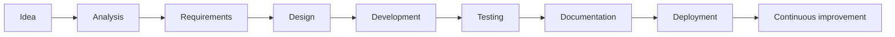
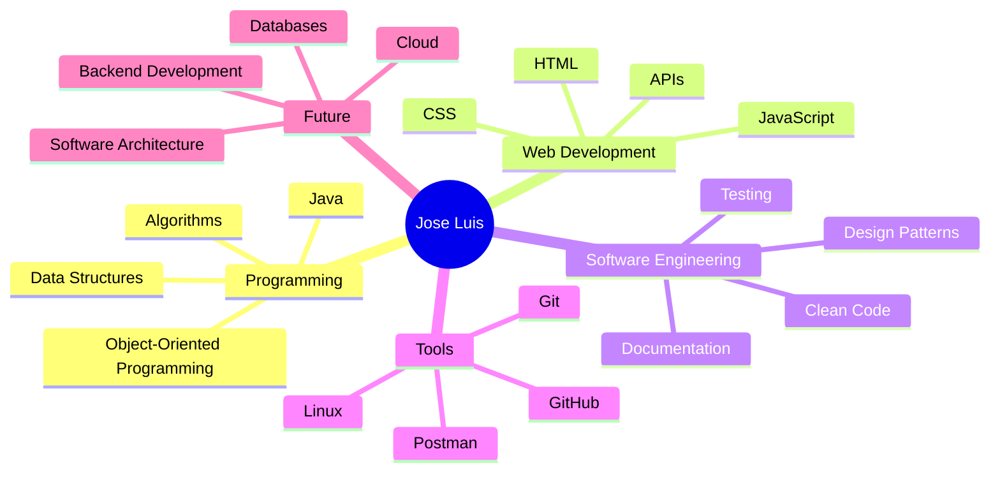

<!--
===============================================================================
  GitHub Profile README
  Name: Jose Luis Rodriguez Navarro
  GitHub: Josepfazt
===============================================================================
-->

<div align="center">


<a href="https://github.com/DenverCoder1/readme-typing-svg">
  
</a>

<br>

<a href="https://github.com/Josepfazt">
  
</a>

<a href="mailto:TU_CORREO_AQUI">
  
</a>

<br><br>


</div>

---

## 👨‍💻 About me

```yaml
name: Jose Luis Rodriguez Navarro
username: Josepfazt
role: Software Developer
location: Lima, Peru

focus:
  - Software Development
  - Object-Oriented Programming
  - Web Applications
  - Software Architecture
  - Continuous Learning

currently:
  learning:
    - Java
    - Object-Oriented Programming
    - Git and GitHub
    - Web Development

  building:
    - Academic projects
    - Personal applications
    - Software development exercises

goals:
  - Build scalable software solutions
  - Improve software architecture skills
  - Contribute to open-source projects
  - Grow as a professional developer
```

Soy **José Luis Rodríguez Navarro**, desarrollador de software apasionado por la tecnología, la programación y la creación de soluciones digitales.

Actualmente me encuentro fortaleciendo mis conocimientos en desarrollo de software, programación orientada a objetos, aplicaciones web y buenas prácticas de ingeniería.

Me interesa entender no solamente cómo escribir código, sino también cómo organizarlo, documentarlo y convertirlo en software mantenible.

- 💻 Desarrollo proyectos académicos y personales.
- ☕ Actualmente trabajo y practico principalmente con **Java**.
- 🧠 Me interesa la arquitectura y el diseño de software.
- 🔧 Busco mejorar continuamente la calidad de mi código.
- 🌱 Estoy aprendiendo nuevas herramientas y tecnologías.
- 🤝 Estoy abierto a colaborar en proyectos tecnológicos.
- 🚀 Mi objetivo es construir soluciones que generen un impacto real.

---

## 🧠 Developer mindset

```text
Understand the problem
        ↓
Plan the solution
        ↓
Design the structure
        ↓
Write clean code
        ↓
Test and improve
        ↓
Document and deliver
```

> El objetivo no es solamente hacer que el código funcione. También debe ser claro, mantenible y capaz de evolucionar.

---

## 🎯 Current objectives

```text
[████████████████░░░░] Java
[██████████████░░░░░░] Object-Oriented Programming
[████████████░░░░░░░░] Git and GitHub
[██████████░░░░░░░░░░] Web Development
[████████░░░░░░░░░░░░] Software Architecture
```

Actualmente estoy enfocado en:

- Fortalecer mis fundamentos de programación.
- Aplicar correctamente la programación orientada a objetos.
- Mejorar la estructura y legibilidad de mis proyectos.
- Aprender patrones y buenas prácticas de desarrollo.
- Crear proyectos que demuestren mis habilidades.
- Documentar correctamente mi proceso de aprendizaje.
- Mejorar el uso de Git y GitHub.

---

## 🛠️ Technology stack

### Languages

<div align="center">


</div>

### Development tools

<div align="center">


</div>

### Operating systems and environments

<div align="center">


</div>

---

## 🧩 Skills in development

<div align="center">


<br>


</div>

---

## 🧬 Developer profile

```java
public final class JoseLuis {

    private final String name;
    private final String username;
    private final String role;
    private final String[] interests;
    private final String[] currentGoals;

    public JoseLuis() {
        this.name = "Jose Luis Rodriguez Navarro";
        this.username = "Josepfazt";
        this.role = "Software Developer";

        this.interests = new String[]{
            "Software Development",
            "Object-Oriented Programming",
            "Web Development",
            "Software Architecture",
            "Clean Code"
        };

        this.currentGoals = new String[]{
            "Improve my programming skills",
            "Build complete software projects",
            "Learn software architecture",
            "Contribute to open-source projects",
            "Grow as a professional developer"
        };
    }

    public String buildSolution(String problem) {
        return String.format(
            "Analyzing '%s', designing the solution and building clean code.",
            problem
        );
    }

    public void keepLearning() {
        System.out.println(
            "Learning, building and improving every day."
        );
    }

    public String getName() {
        return name;
    }

    public String getUsername() {
        return username;
    }

    public String getRole() {
        return role;
    }
}
```

---

## 🏗️ How I approach development



Mi proceso de desarrollo busca mantener una estructura clara:

1. Comprender el problema antes de escribir código.
2. Identificar los requisitos principales.
3. Dividir el problema en componentes más pequeños.
4. Diseñar una solución comprensible.
5. Escribir código limpio y organizado.
6. Probar diferentes escenarios.
7. Documentar las decisiones importantes.
8. Mejorar la solución progresivamente.

---

## 📂 Featured projects

### ☕ Object-Oriented Programming Practice

Repositorio dedicado a ejercicios y prácticas de programación orientada a objetos utilizando Java.

<a href="https://github.com/Josepfazt/SS9">
  
</a>

**Conocimientos practicados:**

- Clases y objetos.
- Atributos y métodos.
- Encapsulamiento.
- Constructores.
- Organización de código.
- Fundamentos de Java.
- Programación orientada a objetos.

---

## 📊 GitHub analytics

<div align="center">


</div>

> Las estadísticas de lenguajes representan la composición de los repositorios públicos y no determinan por sí solas el nivel de conocimiento de una tecnología.

<br>

<div align="center">


</div>

---

## 📈 Activity overview

<div align="center">


</div>

---

## 🐍 Contribution activity

<div align="center">


</div>

> La animación aparecerá después de instalar y ejecutar el workflow incluido al final de esta guía.

---

## 🗺️ Learning roadmap



---

## 📚 Currently learning

```javascript
const currentLearning = {
    programming: [
        "Java",
        "Object-Oriented Programming",
        "Algorithms",
        "Data Structures"
    ],

    webDevelopment: [
        "HTML",
        "CSS",
        "JavaScript",
        "REST APIs"
    ],

    softwareEngineering: [
        "Clean Code",
        "Design Patterns",
        "Software Architecture",
        "Testing"
    ],

    tools: [
        "Git",
        "GitHub",
        "Linux",
        "Postman"
    ]
};

const nextGoal = () => {
    return "Transform knowledge into complete software projects.";
};

console.log(nextGoal());
```

---

## 🤝 Let's connect

Estoy abierto a:

- Colaborar en proyectos académicos.
- Participar en proyectos de software.
- Aprender junto con otros desarrolladores.
- Intercambiar conocimientos y experiencias.
- Contribuir a proyectos open source.
- Conocer nuevas oportunidades tecnológicas.

<div align="center">

<a href="https://github.com/Josepfazt">
  
</a>

<a href="mailto:TU_CORREO_AQUI">
  <img
    src="https://img.shields.io/badge/Contact
